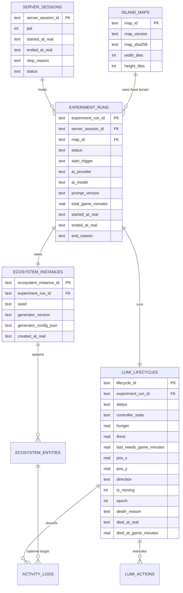
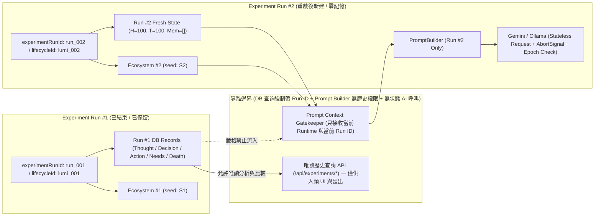
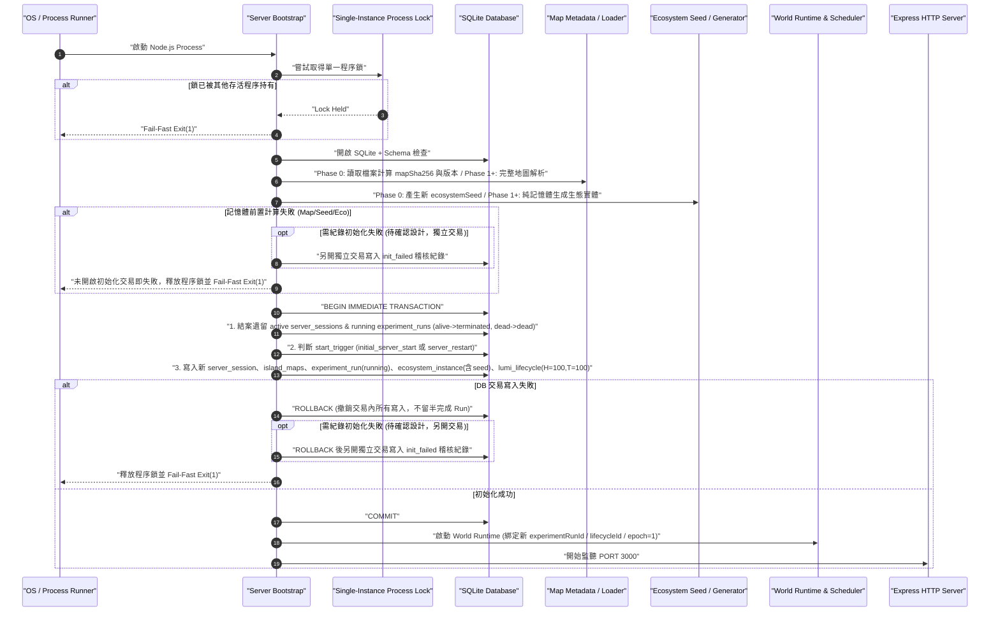

# DigitalIsland — P0 生存系統架構盤點與修訂報告（Revision 2）

**文件狀態**：架構盤點與設計規格書（唯讀盤點任務產出，尚未開始實作）  
**基準倉庫**：`/Users/kouichiwang/Desktop/DigitalIsland`  
**分支 / HEAD**：`master` @ `427d8ddb37a1dfc3de91d33d26e85022de8d797e`  
**最後修訂日期**：2026-11-27  

---

## 1. Executive Summary

DigitalIsland 的核心實驗目標，是觀察一個**完全沒有任何過往記憶**的 AI 模型（Lumi）被放入無人島環境後，如何自主探索、思考、決策與求生。為支持反覆進行可重現且互不污染的實驗，Owner 已正式確認伺服器重啟政策為 **「C：固定地圖，生態重新生成」**：**每次後端 Server Process 重新啟動，即代表一次全新的 Experiment Run、全新的 Ecosystem Instance（含新 Random Seed）與全新的 Lumi Lifecycle（Hunger 100、Thirst 100、零記憶、回到初始座標）**；而前一次實驗的所有紀錄必須永久保留供事後分析與跨實驗比較，且嚴禁流入新一代 Lumi 的任何 Prompt、記憶或決策上下文。

對照現有程式碼檢查結果，目前系統仍處於早期雛形，與修訂後規格存在四項結構性落差：

1. **模擬控制權仍在前端**：遊戲時鐘（`client/src/game/GameClock.ts`）、物理移動與碰撞（`client/src/game/scenes/IslandScene.ts`）、自主決策循環驅動（`client/src/components/GameCanvas.tsx`）皆在瀏覽器執行；後端無頭模擬尚未建立，導致瀏覽器關閉即停止運行，且分頁切換會使 `GameClock` 發生時間跳躍。
2. **四層概念尚未拆分**：現有程式碼沒有 `Server Process`、`Island Map`、`Ecosystem Instance` 與 `Experiment Run / Lumi Lifecycle` 的區分；`server/src/lumi/lumi-controller.ts` 使用全域單例變數，`database/` 為空目錄，重啟後直接覆寫失憶或無紀錄。
3. **固定地圖與生態資產尚未完全解耦**：`assets/maps/island_v2_phaser.json` 具備完整 80×60 網格與 `blocked` 屬性，適合後端無頭碰撞，但地圖中 `Nature` 圖層已靜態烘焙 349 個圖塊，且 `IslandScene.ts` 額外硬編碼了一座靜態 `meatFarm`（`(528, 480)`），尚未接入 `client/public/assets/ecosystem/` 下新增的動態生態圖資。
4. **活動紀錄與隔離機制尚未落地**：現有前端 `EnvironmentRecorder`、`DiagnosticsRecorder` 與未啟用的後端 `lumi-memory.ts` 皆為純記憶體結構，無法持久化完整生命歷程，也缺乏以 `experimentRunId` / `lifecycleId` 為界線的 DB 寫入守衛與舊非同步請求隔離機制。

本修訂版報告在不改動任何程式碼的前提下，重新定義了四層架構邊界、AI 記憶嚴格隔離機制、SQLite 資料模型、啟動／關閉／失敗復原流程，以及低風險分階段實作藍圖。

---

## 2. Owner Confirmed Decisions

以下產品決策已由 Owner 正式確認，屬於不可違背的架構約束，後續設計與實作不得自行變更：

### 2.1 核心實驗與重啟政策（政策 C）
- **重啟即新實驗**：每次後端伺服器重新啟動，必須自動建立一個全新的 `Experiment Run` 與全新的 `Lumi Lifecycle`。
- **固定地圖保留**：島嶼地圖、地形、海岸線、岩石與固定地形障礙、固定碰撞資料保留並重新載入，不因生態重生成而改動。
- **生態重新生成**：植物、花朵、果樹與可採集資源、食物與水源、生態分布每次重啟皆以新的 `Ecosystem Random Seed` 重新生成，且必須符合固定地形與碰撞規則。
- **記憶與狀態完全重置**：新 Lumi 的 Hunger = 100、Thirst = 100、回到設定初始位置、AI 記憶與對話上下文完全歸零。
- **歷史資料永久保留與嚴格隔離**：舊實驗紀錄永久保存供使用者檢視、匯出與跨實驗比較，**禁止**以任何直接或間接方式提供給新 Lumi。

### 2.2 世界運作與時間規則（模式 B）
- **伺服器持續運作**：只要後端 Server Process 正常運作，世界時間、Lumi 自主行動、需求消耗、未來生態演變與活動紀錄即持續推進；瀏覽器關閉、切換分頁或前後端斷線皆不得停止世界。
- **後端權威模擬**：World Clock、World State、Lumi Needs、Action State、Position / Movement、Collision、Death Detection、Ecosystem Simulation、Activity Logging 一律由後端負責；前端 React / Phaser 僅作為唯讀渲染與操作終端。
- **固定時間比例**：沿用既有 `GameClock.ts` 設定，**現實 1 分鐘 = 遊戲 15 分鐘**（`GAME_MINUTES_PER_REAL_MINUTE = 15`，每日起始 `06:00`），不得擅自修改。

### 2.3 生存需求與永久死亡規則
- **雙生存需求**：`Hunger`（0–100）與 `Thirst`（0–100）隨遊戲時間下降，食物與水源可恢復對應數值。
- **需求影響活動效率**：飢餓與口渴會影響移動速度與動作／採集效率，**不得**直接降低 AI 思考頻率或擅自改寫核心決策 Prompt。
- **永久死亡**：`Hunger <= 0` 或 `Thirst <= 0` 任一成立即觸發永久死亡；死亡後永久停止自主行動、AI 思考決策、世界時間推進、生態演變，不自動復活、不自動生成新 Lumi；舊 AI 非同步回應不得覆寫死亡狀態；死亡原因、死亡時間與最終世界狀態必須保留，且仍允許唯讀查詢與 JSON / CSV 匯出。

---

## 3. Server Process Lifecycle

在政策 C 下，必須嚴格區分「程序生命週期」與「實驗生命週期」：

1. **啟動（Boot）**：
   - Node.js 程序啟動 → 產生唯一的 `serverSessionId`（UUID）。
   - 開啟 SQLite 資料庫並取得單一運行程序鎖（避免多程序並發寫入或產生多個 Active Run）。
   - 將資料庫中任何上一次程序遺留且尚未正常關閉的 `server_sessions` / `experiment_runs` **先結案封存**（見第 9 節 Startup Sequence）。
   - 載入唯讀的固定 `Island Map`（`assets/maps/island_v2_phaser.json`）。
   - 在單一原子事務（或可回滾的交易邊界）中建立：新的 `Experiment Run`、新的 `Ecosystem Instance`（含新 `seed`）與新的 `Lumi Lifecycle`（`hunger=100, thirst=100`）。
   - 上述皆成功後才啟動 `World Runtime` 模擬排程器與 Express HTTP Listen。
2. **運行（Running）**：
   - `World Runtime` 以真實經過時間 `deltaRealMs` 推進單調遊戲時間與需求游標，並驅動 Lumi 無頭行動、碰撞與 AI 循環。
   - 若 Lumi 在運行期間死亡，`Experiment Run` 與 `Lumi Lifecycle` 進入終止狀態（`dead` / `stopped`），**Server Process 本身仍可保持存活**以提供前端唯讀檢視與 JSON / CSV 下載。
3. **終止（Shutdown）與重啟（Restart）**：
   - 收到 `SIGINT` / `SIGTERM` 時，停止接收新請求、Abort 進行中的 AI HTTP 請求、停止排程器、將未死亡實驗標記為 `ended_by_server_shutdown`（已死亡者維持 `ended_by_lumi_death`）、關閉 `serverSessionId` 並安全關閉 DB。
   - 若遭遇 `SIGKILL` 或斷電，下一次 Server Process 啟動時會偵測到上一個未正常結案的 Session，將其補標為 `ended_by_unexpected_shutdown`，**絕不恢復舊 Lumi 的行動或 Pending AI 請求**。

### 伺服器停機期間遊戲時間語意分析（對應架構問題 11）

在先前的單一長期世界模型中，「停機期間是否追趕遊戲時間」是待決爭議；但納入 **「重啟即建立新實驗與新 Lumi」** 的政策 C 後，停機語意發生根本改變：

- **舊 Lumi 永不續跑**：當 Server Process 停止時，該次實驗的模擬即實質終止。下次伺服器啟動時面對的是**全新實驗與全新 Lumi**，因此**不得**將停機現實時間追趕並扣減在舊 Lumi 身上，也不得讓舊 Lumi 接續運行。
- **舊實驗的最終遊戲時間軸**：舊實驗的 `final_game_minutes` 應凍結在停機前最後一次持久化落盤的模擬時間點，代表該代 Lumi 在「伺服器實際存活運轉期間」共生存了多少遊戲時間。
- **新實驗的起點**：新實驗固定從遊戲時間 `Day 1 06:00`（`total_game_minutes = 360` 或相對 `elapsed_game_minutes = 0`）重新開始計算。

---

## 4. Island Map / Ecosystem Separation

### 4.1 現有地圖 `island_v2_phaser.json` 的無頭模擬適用性檢查

經唯讀檢查 [island_v2_phaser.json](file:///Users/kouichiwang/Desktop/DigitalIsland/assets/maps/island_v2_phaser.json#L1-L1497) 與 [IslandScene.ts](file:///Users/kouichiwang/Desktop/DigitalIsland/client/src/game/scenes/IslandScene.ts#L88-L325)，確認現有地圖資料狀態如下：

| 檢查項目 | 實際觀察結果 | 後端 Headless Simulation 評估 |
|---|---|---|
| **檔案一致性** | `assets/maps/island_v2_phaser.json` 與 `client/public/assets/maps/island_v2_phaser.json` 位元組完全一致（`diff -q` 通過） | 後端可直接讀取 `assets/maps/island_v2_phaser.json` 作為靜態真相來源，無需依賴瀏覽器。 |
| **地圖規格** | `80 × 60` tiles，`16 × 16` px/tile（`1280 × 960` px），`infinite: false` | 尺寸極小（4,800 格/層），啟動時可全量載入記憶體建構 `O(1)` 碰撞查詢陣列。 |
| **圖層組成** | 6 個 `tilelayer`：`Ocean`（4800 格）、`Shore`（2853 格）、`Island_Ground`（1948 格）、`Cliff_Details`（123 格）、`Rocks`（80 格）、`Nature`（349 格）；另有 1 個空的 `objectgroup` 名為 `Collision`（`objects: []`） | 6 個 Tile Layer 皆可直接解析；但 `Nature` 圖層目前已靜態繪製 349 個植物/樹木圖塊，若未來改由動態生態接管樹木，需在規格上區分「永久地形樹」與「動態可互動樹」。 |
| **碰撞屬性** | 11 個嵌入式 tileset 中共定義 96 筆 `{ name: "blocked", type: "bool", value: true }`，對應 `IslandScene.ts:241` 的 `setCollisionByProperty({ blocked: true })` | 可在後端計算 `firstgid + localTileId -> isBlocked` 對照表；**注意**：[2026-11-26 開發日誌](file:///Users/kouichiwang/Desktop/DigitalIsland/docs/development-log/2026-11-26.md#L50) 曾指出 `Ocean` 滿鋪的 GID `141`（來自 `Terrain_Winter` 佔位）尚未定義語意，後端阻擋邏輯必須與前端 Phaser 一致，不得自行猜測未標記 `blocked` 的 Tile。 |
| **硬編碼物件** | [IslandScene.ts#L265-L271](file:///Users/kouichiwang/Desktop/DigitalIsland/client/src/game/scenes/IslandScene.ts#L265-L271) 與 `#L324` 在 `(528, 480)` 硬編碼建立 `meatFarm` 圖片與碰撞體，此物件**不在** `island_v2_phaser.json` 中 | 屬於臨時測試實體；未來應將動態作物／資源改由 `Ecosystem Instance` 統一生成與下發，避免前後端碰撞不一致。 |
| **新增生態圖資** | 工作目錄未追蹤的 `client/public/assets/ecosystem/` 已包含 `trees/`（芒果、香蕉樹）、`berry_bush/`（4 生長階段）、`vegetation/`（花朵、蕨類、草叢）與 `food/`（漿果、蘑菇、野根、椰子） | 已具備動態生態渲染素材基礎，恰可與固定地形圖層分離管理。 |

### 4.2 固定地圖與生態實例的分離原則

1. **Island Map（不可變靜態層）**：
   - 只包含 `island_v2_phaser.json` 的固定地理結構（`Ocean`、`Shore`、`Island_Ground`、`Cliff_Details`、`Rocks` 及標記 `blocked: true` 的靜態障礙）與地圖版本雜湊（`mapHash` / `mapVersion`）。
   - Ecosystem Generator **唯讀**存取 `Island Map`，絕對不可寫回或修改地圖 JSON 檔。
2. **Ecosystem Instance（每次實驗可變動態層）**：
   - 依該次實驗的 `ecosystemSeed`（使用可重現的確定性 PRNG，例如 Mulberry32 / splitmix64）與 `generatorConfigVersion`，在符合規則的「可通行且非水源／非懸崖地形格」上生成動態植物、花朵、果樹、食物與水源實例。
   - 生態實例的座標、碰撞半徑、生長階段、剩餘資源量皆存於 `ecosystem_entities` 資料表，並以 `ecosystem_instance_id` 隔離。
   - **可重現性**：保留 `ecosystemSeed` 與 `generatorConfigJson` 後，未來只要以相同地圖版本與相同 Seed 執行同一版 Generator，即可重現該次實驗的初始生態分布。

---

## 5. Experiment Run Data Model

### 5.1 四個核心識別 ID 的必要性與關聯設計

為了避免過去「世界狀態、伺服器啟動與 Lumi 個體混為一談」的問題，建議同時保留四個獨立 ID，各自承擔明確邊界：

| 識別 ID | 存在層級 | 產生時機 | 為何必須獨立存在 |
|---|---|---|---|
| **`serverSessionId`** | Server Process | 每次 Node.js 程序啟動 | 區分不同的 OS 行程生命週期；即使未來允許在**同一次伺服器啟動內手動開啟新實驗**（問題 10），同一個 `serverSessionId` 仍能關聯多個先後執行的 `experimentRunId`，且可用來偵測異常斷電／強制終止。 |
| **`experimentRunId`** | Experiment Run | 每次啟動（或未來手動重開實驗） | 作為所有實驗產出物（設定、Prompt 版本、Model、環境、生態、Lumi、紀錄）的頂層隔離與分析主鍵。 |
| **`ecosystemInstanceId`** | Ecosystem Instance | 隨 `experimentRunId` 一對一建立 | 綁定該次實驗的 `seed`、生成規則版本與所有動態資源實體，確保生態資料與固定地圖（`mapVersion`）及 Lumi 個體資料解耦。 |
| **`lifecycleId`** | Lumi Lifecycle | 隨 `experimentRunId` 一對一建立 | 代表該代 Lumi 個體的生命週期（從出生 `hunger=100, thirst=100` 到死亡或實驗終止）。所有 `Lumi` 專屬的思考、決策、行動、需求與死亡事件必須同時綁定 `(experimentRunId, lifecycleId)`，且作為 AI 記憶隔離與 DB 條件寫入的守門憑證。 |

### 5.2 Data Relationship Diagram



---

## 6. Lumi Lifecycle Isolation

### 6.1 Lumi Lifecycle Diagram

```mermaid
stateDiagram-v2
  [*] --> initializing : "Server Startup 建立新 Run"
  initializing --> alive_idle : "生態與 DB 交易提交完成 (H=100, T=100)"
  initializing --> aborted : "地圖/生態/DB 初始化失敗 (回滾)"

  state alive_idle {
    [*] --> idle
    idle --> deciding : "開始 AI 觀察與決策"
    deciding --> acting : "AI 回傳合法 action + duration (180-300s)"
    deciding --> error : "AI Provider 503 / 失敗"
    acting --> idle : "後端累計時間到期完成"
    error --> idle : "自動健康檢查恢復"
  }

  alive_idle --> dead : "Hunger <= 0 或 Thirst <= 0 (寫入死亡與停機)"
  alive_idle --> terminated_by_shutdown : "Server 關閉或下次啟動結案"
  dead --> [*] : "永久終止 (僅唯讀檢視/匯出; 重啟不復活)"
  terminated_by_shutdown --> [*] : "實驗結束 (僅唯讀檢視/匯出; 重啟建新 Lumi)"
  aborted --> [*]
```



### 6.2 生命週期隔離與防跨代污染解答（對應架構問題 2、3、12）

1. **如何確保舊 Experiment Run 已結束，而新 Experiment Run 不會讀取舊資料？**
   - 資料庫層在 `experiment_runs` 建立部分唯一索引（Partial Unique Index）：`CREATE UNIQUE INDEX idx_single_active_run ON experiment_runs(status) WHERE status = 'running'`（SQLite 3.8+ 支援），從資料庫引擎層強制**任何時刻最多只有一個 `running` 實驗**。
   - 啟動新實驗前，先在交易內將所有舊 `status = 'running'` 的實驗與未死亡 Lumi 封存為終止狀態，再插入新的 `running` 實驗。
2. **如果上一代 Lumi 正在執行 AI Request，如何避免結果污染新一代？**
   - **行程層天然隔離（一般重啟）**：當 Server Process 重啟時，舊程序已終止，舊程序內的 Promise 與記憶體指標已隨 OS Process 回收而消滅，不可能在跨程序時寫回新程序。
   - **同行程內過期防護（死亡瞬間或未來手動開新實驗）**：每次 AI 請求攜帶 `{ experimentRunId, lifecycleId, epoch, abortSignal }`：
     - 發出請求時同時保留 `AbortController`。一旦觸發死亡或關閉實驗，立即遞增 `epoch` 並呼叫 `abortController.abort()`。
     - AI 回應返回後，先進行記憶體層驗證（`runId / lifecycleId / epoch / status === 'running'`），**再於寫入 DB 時使用條件式更新（Conditional Write）**：
       ```sql
       UPDATE lumi_lifecycles
       SET controller_state = 'acting', epoch = epoch + 1
       WHERE lifecycle_id = :lifecycleId
         AND experiment_run_id = :experimentRunId
         AND status = 'alive'
         AND epoch = :expectedEpoch;
       ```
       且活動紀錄寫入須先確認 `EXISTS (SELECT 1 FROM lumi_lifecycles WHERE lifecycle_id = :id AND status = 'alive')`（或僅針對事件當下有效的 Run 寫入）。若 `changes === 0` 則拋棄結果，保證絕對無法污染已死亡或新一代實驗。
3. **如果舊 Lumi 是因為死亡而停止，伺服器重啟後應如何保存死亡紀錄並建立新 Lumi？**
   - 舊 Lumi 死亡時，DB 早已將 `experiment_runs.status = 'stopped'`、`end_reason = 'lumi_death'` 與 `lumi_lifecycles.status = 'dead'`、`death_reason`、`died_at_real` 持久化。
   - 下次伺服器重啟時：
     - 結案檢查器看到舊實驗已經是 `stopped / dead`，**保留原狀不覆寫其 `end_reason` 或死亡時間**。
     - 接著依照政策 C 直接插入全新的 `experiment_runs`、`ecosystem_instances` 與 `lumi_lifecycles`（新 ID、新種子、H=100、T=100）。
     - 使用者透過歷史查詢介面仍可完整調閱前幾代「已死亡實驗」的死因、時間線與 JSON/CSV 匯出。

---

## 7. AI Memory Isolation（最高優先級）

### 7.1 現有專案潛在污染源盤點（12 項逐一檢查）

對照目前實際程式碼檢查結果如下：

| # | 潛在污染源 | 現有程式檢查結果 | 隔離設計要求 |
|---|---|---|---|
| 1 | **Previous Thought Records** | 目前僅存前端 `App.tsx:23` 的 `lumiThought` state 與 `lumi-memory.ts:13`（未使用） | 每個 `thought` 紀錄必須綁定 `(experimentRunId, lifecycleId)`；新實驗開始時前端與後端必須清空舊 thought 顯示，且 Prompt 查詢只允許 `WHERE experiment_run_id = :currentRunId`。 |
| 2 | **Previous Decision Records** | 目前無 DB，僅 `lumi-controller.ts` 記憶體狀態 | 決策紀錄入庫綁定 `(experimentRunId, lifecycleId)`，新 Lumi 查詢強制限定當前 ID。 |
| 3 | **Previous Action Records** | 目前僅 `lumi-controller.ts:12` `activeActionId` 與 `IslandScene.ts:167` `activeAction` | 同上；此外若瀏覽器分頁在後端重啟期間保持開啟，`GameCanvas.tsx` 必須比對後端回傳的 `experimentRunId`，一有變更立即清除前端殘留 `activeAction` 並停止舊動作動畫。 |
| 4 | **Previous Activity Logs** | 目前僅前端 `EnvironmentRecorder.ts:41` 記憶體陣列 | **嚴重前端殘留風險**：若瀏覽器未重整而後端重啟，`EnvironmentRecorder` 會混錄兩代資料。前端必須依 `experimentRunId` 重置本地除錯緩存；後端 `ActivityLogger` 強制要求帶入 `experimentRunId`。 |
| 5 | **Previous Conversation History** | 經檢查 `server/src/lumi/lumi-ai.ts`，目前 `askLumiAI` 與 `decideLumiAction` 皆為單輪 Prompt（無對話歷史陣列） | 未來若引入多輪對話歷史，必須以 `lifecycleId` 為鍵建立獨立實例，禁止跨 `lifecycleId` 讀取或初始化。 |
| 6 | **Previous AI Provider Conversation IDs** | 經檢查 `lumi-ai.ts:232`（`ai.models.generateContent`）與 `lumi-ai.ts:170`（`Ollama /api/chat` `stream: false`），目前皆為**無狀態（stateless）單次呼叫**，未使用 Gemini Chats / Interactions API 或 Ollama `context` token 陣列 | **架構規範鎖定**：維持完全無狀態呼叫方式（不傳 `previous_interaction_id`、不複用 `chat` session、不傳 Ollama `context`）；若未來必須使用 Provider session，規定每次新 `lifecycleId` 必須建立新 session 且不得沿用舊 ID。 |
| 7 | **Previous Prompt Context** | 目前 `lumi-ai.ts` Prompt 由 `LUMI_PERSONA` + `OBSERVATION_INSTRUCTIONS` / `ACTION_INSTRUCTIONS` + 當次 `observation` 組成 | Prompt Builder 實作時必須採**白名單依賴注入**：只接收當前 `ExperimentRunContext`（當前地圖感知、當前生態、當前 `LumiNeeds`、當前實驗自身短期記憶），**API 介面層根本不傳入 `Database` 全表查詢器**。 |
| 8 | **Previous In-memory State** | [lumi-controller.ts](file:///Users/kouichiwang/Desktop/DigitalIsland/server/src/lumi/lumi-controller.ts#L11-L18) 的 `currentState`、`activeActionId`、`isRecovering`、`recoveryAttemptIndex`、`recoveryTimer` 皆為模組層全域單例 | 改由封裝在具生命週期歸屬的 `ExperimentSession` 物件內，不暴露跨實驗可複用的全域狀態；啟動新實驗時建構全新實例，舊實例顯式 `dispose()` 並清除 Timer。 |
| 9 | **Previous Pending AI Requests** | [lumi-controller.ts#L124](file:///Users/kouichiwang/Desktop/DigitalIsland/server/src/lumi/lumi-controller.ts#L124) 與 [lumi-ai.ts#L222-L293](file:///Users/kouichiwang/Desktop/DigitalIsland/server/src/lumi/lumi-ai.ts#L222-L293)（含 503 retry loop）無 `AbortSignal` 與版本檢查 | 為所有 `generateLumiResponse` 加入 `AbortSignal` 與 `epoch` 檢查；重試迴圈若偵測到 `signal.aborted` 立即中止；回傳前驗證 `(experimentRunId, lifecycleId, epoch)`。 |
| 10 | **Previous Lumi Memory Objects** | [lumi-memory.ts#L34-L42](file:///Users/kouichiwang/Desktop/DigitalIsland/server/src/lumi/lumi-memory.ts#L34-L42) 為模組層單例 `const memory`（目前雖未被呼叫，但結構上屬於全域共用的記憶物件） | **高潛在風險**：未來啟用記憶系統時，禁止使用模組全域 `const memory`；必須改為綁定 `lifecycleId` 的結構或帶 `WHERE experiment_run_id = ? AND lifecycle_id = ?` 的 Repository，禁止無條件查詢。 |
| 11 | **Previous World State** | 目前僅前端 `App.tsx` 與 `GameClock.ts` 單例 | 後端 `WorldRuntime` 依新 `experimentRunId` 重新初始化；前端連線比對 `experimentRunId` 變更時強制重置本地 `GameClock`、`IslandScene` 位置與 `recordedCollisionTiles`（`IslandScene.ts:165`）。 |
| 12 | **其他間接讀取路徑** | 例如環境快照 `LumiSnapshot`、錯誤日誌、檔案匯出快取、`lumi-persona.ts` | 禁止將「歷史實驗分析 API」或「舊 `activity_logs`」掛入任何 Prompt Builder 可存取的服務模組；檔案架構上將 `PromptBuilder` 與 `HistoricalQueryService` 隔離於不同模組邊界。 |

### 7.2 新舊 Experiment Run 隔離示意圖



---

## 8. Database Schema Proposal

建議使用 SQLite（置於專案既有空目錄 `database/digitalisland.sqlite`，啟用 `PRAGMA foreign_keys = ON;` 與 `PRAGMA journal_mode = WAL;`）。所有與某次實驗相關的表皆強制包含 `experiment_run_id` 欄位並建立對應索引：

```sql
-- 1. Server Process 紀錄
CREATE TABLE server_sessions (
  server_session_id TEXT PRIMARY KEY,
  pid INTEGER NOT NULL,
  started_at_real TEXT NOT NULL,
  last_heartbeat_real TEXT NOT NULL,
  ended_at_real TEXT,
  stop_reason TEXT, -- 'graceful_shutdown' | 'unexpected_crash_reconciled' | NULL
  status TEXT NOT NULL CHECK (status IN ('active', 'ended'))
);

-- 2. 固定地圖版本註冊（唯讀中繼資料，不放動態生態）
CREATE TABLE island_maps (
  map_id TEXT PRIMARY KEY,
  map_version TEXT NOT NULL,
  map_sha256 TEXT NOT NULL,
  width_tiles INTEGER NOT NULL,
  height_tiles INTEGER NOT NULL,
  tile_size_px INTEGER NOT NULL,
  created_at_real TEXT NOT NULL
);

-- 3. 實驗執行主表
CREATE TABLE experiment_runs (
  experiment_run_id TEXT PRIMARY KEY,
  server_session_id TEXT NOT NULL REFERENCES server_sessions(server_session_id),
  map_id TEXT NOT NULL REFERENCES island_maps(map_id),
  status TEXT NOT NULL CHECK (status IN ('initializing', 'running', 'stopped', 'aborted')),
  start_trigger TEXT NOT NULL CHECK (start_trigger IN ('server_restart', 'manual_new_experiment')),
  ai_provider TEXT NOT NULL,
  ai_model TEXT NOT NULL,
  prompt_version TEXT NOT NULL,
  game_minutes_per_real_minute REAL NOT NULL DEFAULT 15.0,
  total_game_minutes REAL NOT NULL DEFAULT 360.0,
  started_at_real TEXT NOT NULL,
  ended_at_real TEXT,
  end_reason TEXT -- 'lumi_death' | 'server_shutdown' | 'unexpected_shutdown' | 'manual_reset' | 'init_failed' | NULL
);

-- 硬性保證同一時刻最多只有一個 running 實驗
CREATE UNIQUE INDEX idx_experiment_single_running
  ON experiment_runs(status) WHERE status = 'running';

-- 4. 生態實例與 Seed 保存
CREATE TABLE ecosystem_instances (
  ecosystem_instance_id TEXT PRIMARY KEY,
  experiment_run_id TEXT NOT NULL UNIQUE REFERENCES experiment_runs(experiment_run_id),
  seed TEXT NOT NULL,
  generator_version TEXT NOT NULL,
  generator_config_json TEXT NOT NULL,
  created_at_real TEXT NOT NULL
);

CREATE TABLE ecosystem_entities (
  entity_id TEXT PRIMARY KEY,
  ecosystem_instance_id TEXT NOT NULL REFERENCES ecosystem_instances(ecosystem_instance_id),
  experiment_run_id TEXT NOT NULL REFERENCES experiment_runs(experiment_run_id),
  entity_type TEXT NOT NULL, -- 'berry_bush' | 'mango_tree' | 'water_spring' | ...
  tile_x INTEGER NOT NULL,
  tile_y INTEGER NOT NULL,
  pos_x REAL NOT NULL,
  pos_y REAL NOT NULL,
  stage TEXT NOT NULL,
  growth_game_minutes REAL NOT NULL DEFAULT 0,
  last_updated_game_minutes REAL NOT NULL,
  remaining_yield INTEGER NOT NULL DEFAULT 0,
  is_collidable INTEGER NOT NULL DEFAULT 0,
  metadata_json TEXT
);

CREATE INDEX idx_eco_entities_run
  ON ecosystem_entities(experiment_run_id, ecosystem_instance_id);

-- 5. Lumi 生命週期與即時權威狀態
CREATE TABLE lumi_lifecycles (
  lifecycle_id TEXT PRIMARY KEY,
  experiment_run_id TEXT NOT NULL UNIQUE REFERENCES experiment_runs(experiment_run_id),
  status TEXT NOT NULL CHECK (status IN ('alive', 'dead', 'terminated')),
  controller_state TEXT NOT NULL CHECK (controller_state IN ('idle', 'deciding', 'acting', 'error', 'dead', 'terminated')),
  hunger REAL NOT NULL CHECK (hunger >= 0 AND hunger <= 100),
  thirst REAL NOT NULL CHECK (thirst >= 0 AND thirst <= 100),
  last_needs_game_minutes REAL NOT NULL,
  pos_x REAL NOT NULL,
  pos_y REAL NOT NULL,
  direction TEXT NOT NULL,
  is_moving INTEGER NOT NULL DEFAULT 0,
  epoch INTEGER NOT NULL DEFAULT 1,
  latest_thought TEXT,
  death_reason TEXT,
  died_at_real TEXT,
  died_at_game_minutes REAL,
  created_at_real TEXT NOT NULL
);

-- 6. 行動紀錄（支援執行中進度與歷史分析）
CREATE TABLE lumi_actions (
  action_id TEXT PRIMARY KEY,
  experiment_run_id TEXT NOT NULL REFERENCES experiment_runs(experiment_run_id),
  lifecycle_id TEXT NOT NULL REFERENCES lumi_lifecycles(lifecycle_id),
  action_type TEXT NOT NULL,
  duration_seconds INTEGER NOT NULL,
  started_at_real TEXT NOT NULL,
  started_at_game_minutes REAL NOT NULL,
  expected_end_at_real_ms INTEGER NOT NULL,
  elapsed_real_ms REAL NOT NULL DEFAULT 0,
  start_x REAL NOT NULL,
  start_y REAL NOT NULL,
  end_x REAL,
  end_y REAL,
  status TEXT NOT NULL CHECK (status IN ('running', 'completed', 'interrupted_by_death', 'interrupted_by_shutdown')),
  result_summary TEXT
);

CREATE INDEX idx_actions_run_lifecycle
  ON lumi_actions(experiment_run_id, lifecycle_id, started_at_game_minutes);

-- 7. 完整活動稽核日誌（觀察、思考、決策、行動、需求變化、死亡）
CREATE TABLE activity_logs (
  id INTEGER PRIMARY KEY AUTOINCREMENT,
  experiment_run_id TEXT NOT NULL REFERENCES experiment_runs(experiment_run_id),
  lifecycle_id TEXT NOT NULL REFERENCES lumi_lifecycles(lifecycle_id),
  sequence INTEGER NOT NULL,
  event_type TEXT NOT NULL,
  real_timestamp TEXT NOT NULL,
  game_minutes REAL NOT NULL,
  game_time_formatted TEXT NOT NULL,
  pos_x REAL NOT NULL,
  pos_y REAL NOT NULL,
  observation_json TEXT,
  thought_content TEXT,
  action_id TEXT,
  action_type TEXT,
  action_duration_seconds INTEGER,
  action_result TEXT,
  hunger_before REAL,
  hunger_after REAL,
  thirst_before REAL,
  thirst_after REAL,
  death_reason TEXT,
  metadata_json TEXT,
  UNIQUE (experiment_run_id, sequence)
);

CREATE INDEX idx_activity_run_seq
  ON activity_logs(experiment_run_id, sequence);
```

> **說明**：所有跨實驗查詢一律唯讀 `experiment_runs`、`ecosystem_instances`、`lumi_lifecycles`、`lumi_actions` 與 `activity_logs`；AI Prompt 路徑僅允許存取**記憶體中當前 Active Run 物件**或強制附帶 `WHERE experiment_run_id = :currentRunId AND lifecycle_id = :currentLifecycleId` 的隔離 Repository。

---

## 9. Startup / Shutdown Sequence

### 9.1 Server Startup Sequence Diagram（設計提案）



### 9.2 Startup 結案規則、`start_trigger` 判定與 Process Lock

1. **`start_trigger` 明確區分（Phase 0 僅實作前兩種）**：
   - `initial_server_start`：資料庫中尚無任何歷史 `experiment_runs` 時的首次啟動。
   - `server_restart`：資料庫中已存在先前的 `experiment_runs` 時的後續每次伺服器啟動。
   - `manual_new_experiment`：保留給未來在不重啟伺服器下手動開啟新實驗使用；**暫不納入 Phase 0**（是否實作待 Owner 確認）。
2. **單一程序鎖（Process Lock）策略與 `SIGKILL` stale lock 處理（設計提案，選型待確認）**：
   - **僅依賴 PID 檔案的風險**：
     - *競爭條件（TOCTOU）*：兩支程序同時檢查 PID 檔是否存在並嘗試刪除或覆寫，可能彼此踩踏。
     - *`SIGKILL` 殘留 stale lock*：程序遭 `SIGKILL` 或斷電後，PID 檔不會被刪除。
     - *PID 重用（PID Reuse）誤判*：作業系統可能將已死亡舊程序的 PID 分配給其他無關程序，導致單純用 `kill(pid, 0)` 誤判「伺服器仍在運行」而拒絕啟動，或在競態下兩支新程序同時判定舊 PID 已死並一起 `unlink` 鎖檔、導致雙雙啟動成功。
   - **兩類主流鎖定機制之本質差異（不可混為一談）**：
     - **OS 核心層 Advisory File Lock（如 `flock` / `fcntl`）**：由作業系統核心維護開檔 File Descriptor 上的鎖定狀態；當程序遭遇 `SIGKILL` 或崩潰時，核心自動關閉 FD 並釋放鎖，天然免疫 stale lock 與 PID 重用。
     - **檔案系統層鎖套件（如 `proper-lockfile`）**：屬於使用者態檔案系統鎖（通常透過建立鎖目錄與定期更新 mtime／檢查 stale 閾值運作），並非核心 FD advisory lock，在極端停頓或時鐘漂移下仍有 mtime 續約與 stale 判定邊界需處理。
   - **架構原則**：禁止實作天真的「檢查 PID 檔 → 若死則 `unlink` → 建檔」流程；實際採用 OS Advisory Lock 或檔案系統鎖套件列於第 14 節 Open Questions，並一律輔以 SQLite `idx_experiment_single_running` 部分唯一索引作為資料庫層互斥防線。

### 9.3 Graceful & Ungraceful Shutdown

1. **Graceful Shutdown（`SIGINT` / `SIGTERM`）**：
   - 設定 `shuttingDown = true`，停止 Simulation Scheduler 新 tick。
   - 觸發 `AbortController.abort()` 取消飛行中 AI 請求並遞增記憶體 `epoch`。
   - 於 SQLite Transaction 內結案當前實例：
     - 進行中的 `lumi_actions`（`status = 'running'`）→ 更新為 `'interrupted_by_shutdown'`。
     - `lumi_lifecycles`：若為 `'alive'` → 轉為 `'terminated'`（`death_reason` 維持 `NULL`）；**若已是 `'dead'` → 維持 `'dead'`，保留原 `death_reason` 與死亡時間**。
     - `experiment_runs`：若仍為 `'running'` → 轉為 `'stopped'`、`end_reason = 'server_shutdown'`；若已因死亡結束 → 維持 `'stopped'`、`end_reason = 'lumi_death'`。
     - `server_sessions`：`status = 'ended'`、`stop_reason = 'graceful_shutdown'`。
   - 關閉 SQLite 連線並釋放程序鎖。
2. **Ungraceful Shutdown（當機 / `SIGKILL` / 斷電）與重啟結案規則**：
   - 遭遇 `SIGKILL` 時程序無法執行 shutdown hook。下一次 Server Startup 在建立新實驗前的同一個交易內，必須對所有遺留的 `server_sessions(status = 'active')` 與未結案實驗執行對帳結案：
     - 遺留 `lumi_actions(status = 'running')` → 標記為 `'interrupted_by_shutdown'`。
     - 遺留 `lumi_lifecycles`：
       - **`alive` → 強制轉為 `terminated`**（`controller_state = 'terminated'`、`death_reason = NULL`、`died_at_real = NULL`、`died_at_game_minutes = NULL`）。
       - **`dead` → 保持 `dead`**（保留原本生物學死因與死亡時間，絕不覆寫）。
       - **已為 `terminated` 或 `dead` 者 → 嚴禁重新啟動、回復為 `alive` 或續跑任何行動**。
     - 遺留 `experiment_runs(status IN ('initializing', 'running'))` → 若其關聯之 Lumi 仍為 `alive`（現已轉為 `terminated`），設為 `status = 'stopped'`、`end_reason = 'unexpected_shutdown'`；若關聯之 Lumi 已為 `dead`，則保持／設為 `status = 'stopped'`、`end_reason = 'lumi_death'`。
     - 遺留 `server_sessions(status = 'active')` → 設為 `status = 'ended'`、`stop_reason = 'unexpected_crash_reconciled'`。
   - **嚴格語意區分**：`server_shutdown` / `unexpected_shutdown` 造成的結束只會產生 `lumi_lifecycles.status = 'terminated'` 且 `death_reason = NULL`；**絕對不可**將伺服器當機或重啟誤記為 `STARVATION`、`DEHYDRATION` 等 Lumi 生物死亡原因。

---

## 10. Failure Handling（對應架構問題 3、4、5、9）

### 10.1 Startup Initialization Failure（區分記憶體計算失敗與 DB 交易失敗）
啟動流程嚴格將「純記憶體前置計算（地圖讀取／生態生成）」置於「`BEGIN IMMEDIATE` 資料庫交易」**之前**：

1. **階段 A — 記憶體前置計算失敗（Map Loading / Ecosystem Seed 或實體生成失敗）**：
   - 此時 **`BEGIN IMMEDIATE` 尚未開始**，因此不存在交易內回滾，**不可描述為 `ROLLBACK`**。
   - 資料庫仍維持啟動前的乾淨狀態（尚未結案舊 Run、亦未寫入新 Run）。
   - 若需要留下 `init_failed` 稽核紀錄（待確認設計），必須另開一筆獨立短交易寫入失敗事件；隨後釋放程序鎖並 Fail-Fast 退出（Exit 1）。
2. **階段 B — 資料庫交易寫入失敗（`BEGIN IMMEDIATE` 之後失敗）**：
   - 在 `BEGIN IMMEDIATE` 交易內執行「結案舊 Run ＋ 建立 `server_session` ＋ 註冊 `island_maps` ＋ 寫入 `experiment_run` ＋ 寫入 `ecosystem_instance`（及 Phase 1+ 的 `ecosystem_entities`）＋ 建立 `lumi_lifecycle`」時若發生 SQLite 例外：
   - **必須立即執行 `ROLLBACK`**：該交易內所有寫入完全撤銷，確保資料庫不存在半完成的 `running` Run 或殘缺 Lumi。
   - **交易外另開交易紀錄 `init_failed`（設計提案，待確認）**：由於 `ROLLBACK` 後原交易內建立的 `server_session` 與 `experiment_run` 已不存在，若需要在資料庫保留初始化失敗紀錄，**必須在 `ROLLBACK` 之後另開一筆全新的獨立短交易**寫入（例如寫入獨立的 `aborted` / `init_failed` 紀錄），絕不可假設 `ROLLBACK` 後原交易內的資料仍然存在。
   - 記錄錯誤後釋放程序鎖並安全退出（Fail-Fast Exit 1），不啟動 `WorldRuntime` 與 HTTP 自主服務。

### 10.2 資料庫建立新 Experiment Run 失敗
- 若 SQLite 無法開啟、Schema 建立失敗或建立新實驗失敗：
  - **嚴禁**降級回純記憶體假模擬（會違反持久化、重啟隔離與紀錄保存規格）。
  - 預設採 **Fail-Fast** 停止啟動並退出；若僅新實驗寫入失敗但歷史資料可讀，是否提供「純唯讀歷史查詢模式（不啟動模擬與 AI）」列為待確認選項。

### 10.3 多程序併發啟動保護
- 由第 9.2 節的單一程序鎖（OS Advisory Lock 或經評估的檔案鎖定機制）與 DB `idx_experiment_single_running`（交易層互斥索引）雙重保護。第二個啟動的程序在取鎖階段即立刻失敗退出，絕不會同時寫入或雙重運行 Lumi。

### 10.4 AI Request Isolation 與統一 `Epoch` 管理（禁止只依賴 `AbortController`）
僅依賴 `AbortController` 並不足夠（原因：SDK/網路層回呼可能已排入微任務佇列、部分 HTTP client 在連線邊界無法即時中止、或重試間隔期間正好發生狀態切換）。因此必須由以下 **5 道機制共同協作**：

1. **`experimentRunId` 邊界檢查**：每個非同步 AI 呼叫封裝當次 `experimentRunId`；回應後若與目前 Active Session 不符，直接丟棄。
2. **`lifecycleId` 邊界檢查**：同時核對 `lifecycleId`，確保請求屬於當前這代 Lumi 個體，杜絕任何同 Run 或跨代混用。
3. **`epoch` 單調樂觀鎖與單一權威管理**：
   - **唯一管理元件**：`epoch` 只能由單一權威生命週期協調器（`WorldRuntime` / `LumiLifecycleCoordinator`，於 Phase 0 尚未啟用 Runtime 時則為 `LumiLifecycleRepository`）統一維護與遞增；**嚴禁** AI Client、HTTP Route、Scheduler Tick 或 Activity Logger 自行遞增 `epoch`，避免併發競態。
   - **明確遞增時機**：
     - *會遞增 `epoch` 的狀態轉換*：`initializing -> alive/idle`（初始 `1`）、`idle -> deciding`、`deciding -> acting`、`deciding -> error`、`error -> idle`、`acting -> idle`、轉入 `dead`、轉入 `terminated`、Shutdown 逾時強制鎖定。
     - *不會遞增 `epoch` 的操作*：唯讀查詢、同一 `controller_state` 下的定期座標/需求數值更新（未發生死亡或狀態切換時）、寫入 `activity_logs`。
   - 發起 AI 決策或思考前擷取 `expectedEpoch`；回應返回時若 `currentEpoch !== expectedEpoch`，代表期間已發生其他狀態轉換，立即作廢。
4. **`AbortSignal` 主動中止**：將 `AbortSignal` 傳入 `lumi-ai.ts` 的 `generateLumiResponse`（包含 Gemini 呼叫與 503 retry sleep loop，以及 Ollama `fetch`），當死亡或停機發生時立即中斷等待與重試。
5. **DB 條件式更新（最終原子防線）**：所有由 AI 回應觸發的狀態變更與行動寫入，必須透過資料庫條件式更新執行：
   ```sql
   UPDATE lumi_lifecycles
   SET controller_state = 'acting', epoch = epoch + 1
   WHERE lifecycle_id = :lifecycleId
     AND experiment_run_id = :experimentRunId
     AND status = 'alive'
     AND controller_state = 'deciding'
     AND epoch = :expectedEpoch;
   ```
   並檢查受影響列數 `changes === 1`；若 `changes === 0`（例如該代 Lumi 已死亡、`terminated` 或已有新實驗），立即回滾該次行動與活動寫入並丟棄結果。藉此保證**即使舊 AI 請求在新實驗啟動後才返回，也絕對無法修改新 Lumi 或已死亡 Lumi 的狀態**。

---

## 11. Historical Experiment Query（對應架構問題 7、8、10）

### 11.1 歷史資料隔離原則（強制規則）
- **嚴格單向可見性**：`HistoricalExperimentQueryService`（人類觀察者查詢與匯出層）可以唯讀檢視與比較所有舊實驗資料；**新 Lumi 的 `PromptBuilder` 與 AI 決策管道完全不得存取歷史查詢服務、歷史查詢資料通道或未限定 `experimentRunId` 的資料庫查詢介面**。
- **保存不等於可讀**：永久保留舊實驗資料是為了人類分析、可重現性與實驗比較，**不代表**新 Lumi 可以任何直接或間接方式讀取舊實驗的思考、決策、行動、記憶或世界狀態。

### 11.2 Experiment Metadata 與跨實驗比較欄位評估
為確保未來比較不同實驗時能精準對照所有實驗條件（而不只比較 `ecosystemSeed`），評估在 `experiment_runs` / 實驗查詢回應中完整保存並呈現以下不可變中繼資料（建議於第 8 節 Schema 之 `experiment_runs` 補充對應欄位或 Snapshot 欄位）：

| 欄位建議 | 用途與比較價值 | 目前 Schema 對照與修訂建議 |
|---|---|---|
| **`mapId` / `mapVersion` / `mapSha256`** | 驗證兩次實驗是否跑在完全相同的固定地圖檔案上 | 第 8 節已設計 `island_maps` 外鍵關聯；建議查詢 Metadata 時一律展開帶出 `mapVersion` 與 `mapSha256`。 |
| **`configSnapshot`（`config_snapshot_json`）** | 凍結該次實驗啟動時的環境參數快照（時間比例 `15x`、初始 H/T、未來衰減速率、效率倍率表、行動秒數上下限 `180–300s` 等），避免日後調整全域預設值後誤讀舊實驗條件 | 第 8 節僅有 `game_minutes_per_real_minute`；**建議於 `experiment_runs` 新增 `config_snapshot_json`（TEXT）** 記錄不可變實驗設定快照（具體納入欄位待確認）。 |
| **`serverSessionId`** | 追蹤該次實驗是由哪一個 Server Process 所承載（可辨識重啟次數與異常當機背景） | 第 8 節 `experiment_runs` 已包含 `server_session_id`。 |
| **`ecosystemInstanceId`**（+ `seed`, `generatorVersion`） | 明確關聯該次實驗的動態生態實例與生成規則版本 | 第 8 節採 `ecosystem_instances.experiment_run_id` 一對一關聯；查詢層可直接組合回傳 `ecosystemInstanceId`、`seed` 與 `generatorVersion`（或於 `experiment_runs` 冗餘索引方便查詢）。 |
| **`aiProvider` / `aiModel` / `promptVersion`** | 對照不同模型（如 Gemini vs Ollama `qwen3.5:2b`）與不同 Prompt 版本下的生存時長與行為差異 | 第 8 節 `experiment_runs` 已包含此三欄；建議定義 `promptVersion` 為 `LUMI_PERSONA` + 指令模板的內容雜湊或明確版本號。 |
| **`startTrigger`** | 區分 `initial_server_start`、`server_restart` 與未來的 `manual_new_experiment` | 建議將第 8 節 `experiment_runs.start_trigger` 的 `CHECK` 約束擴充為包含這三種值。 |

### 11.3 唯讀查詢與匯出端點（設計提案）
- `GET /api/experiments`：列出所有歷史與當前實驗完整 Metadata 摘要與統計（存活遊戲時間、最終需求、死因／結束原因、行動次數）。
- `GET /api/experiments/:experimentRunId`：取得單次實驗完整條件快照（含上述所有 Metadata）、生態資訊與 Lumi 最終狀態。
- `GET /api/experiments/:experimentRunId/activities`：分頁查詢活動紀錄。
- `GET /api/experiments/:experimentRunId/export?format=json|csv`：匯出單次實驗完整 JSON 或 CSV（RFC 4180 跳脫 + UTF-8 BOM）。
- `GET /api/experiments/compare?ids=run1,run2`（未來擴充）：跨實驗條件與結果對比。

---

## 12. Existing Architecture Impact Analysis

對照本報告檢查過的所有原始碼檔案，逐項評估現有 12 個系統的修改必要性：

| # | 系統名稱 | 現有程式位置與實作狀態 | 修訂版影響與處置建議 |
|---|---|---|---|
| 1 | **World Runtime** | 尚未實作（`server/src/simulation/` 為空） | **Phase 2 新增**：承接當前 `experimentRunId`、`lifecycleId`、`epoch`、時間推進與狀態同步。 |
| 2 | **Simulation Scheduler** | 尚未實作 | **Phase 2 新增**：以真實時間 `deltaRealMs` 驅動，取代前端 `IslandScene.update()` 推動時鐘與行動計時。 |
| 3 | **World Clock** | [GameClock.ts](file:///Users/kouichiwang/Desktop/DigitalIsland/client/src/game/GameClock.ts#L1-L88)（前端記憶體單例，15x 比例） | **Phase 2 修訂**：保留 `15x` 與 `DayPeriod` 算法，推進權威移至後端；前端改為對齊後端時間，並於 `experimentRunId` 變更時重置。 |
| 4 | **Lumi Needs Engine** | [LumiNeeds.ts](file:///Users/kouichiwang/Desktop/DigitalIsland/client/src/game/LumiNeeds.ts#L1-L9)（靜態 100/100）與 [App.tsx#L19-L21](file:///Users/kouichiwang/Desktop/DigitalIsland/client/src/App.tsx#L19-L21) | **Phase 3 修訂**：移入後端依遊戲時間差扣減、clamp `[0, 100]` 並計算效率倍率；Phase 0 僅於 DB 建立初始 `100/100` 欄位，暫不啟用消耗。 |
| 5 | **Lumi Autonomy State Machine** | [lumi-controller.ts](file:///Users/kouichiwang/Desktop/DigitalIsland/server/src/lumi/lumi-controller.ts#L1-L184)（模組單例，無 `dead`、無 DB、無 `epoch`） | **Phase 0 建表 / Phase 2–3 重構**：移除跨實驗全域單例；加入 `dead` / `terminated`、`(experimentRunId, lifecycleId, epoch)`、`AbortSignal` 與 DB 條件式更新。 |
| 6 | **Headless Map / Collision System** | [IslandScene.ts#L221-L325](file:///Users/kouichiwang/Desktop/DigitalIsland/client/src/game/scenes/IslandScene.ts#L221-L325) 與 [EnvironmentPerception.ts](file:///Users/kouichiwang/Desktop/DigitalIsland/client/src/game/EnvironmentPerception.ts#L21-L72)（僅前端） | **Phase 1 新增後端唯讀地圖解析 / Phase 2 切換移動權威**：Phase 0 不修改現有 Phaser 移動與碰撞。 |
| 7 | **Ecosystem Generator** | 尚未實作（`client/public/assets/ecosystem/` 已備素材；`IslandScene.ts:265` 硬編碼 `meatFarm`） | **Phase 1 新增**：依新 `seed` 於可通行格生成動態生態，嚴格不改寫 `island_v2_phaser.json`。 |
| 8 | **Activity Logger** | 前端有 [EnvironmentRecorder.ts](file:///Users/kouichiwang/Desktop/DigitalIsland/client/src/game/EnvironmentRecorder.ts) 與 [DiagnosticsRecorder.ts](file:///Users/kouichiwang/Desktop/DigitalIsland/client/src/game/DiagnosticsRecorder.ts)；後端 [lumi-memory.ts](file:///Users/kouichiwang/Desktop/DigitalIsland/server/src/lumi/lumi-memory.ts) 未使用 | **Phase 4 新增後端系統**：建立依 `experimentRunId` 隔離的 `activity_logs` 寫入；嚴格與 `PromptBuilder` 隔離。 |
| 9 | **AI Provider / Prompt Builder** | [lumi-ai.ts](file:///Users/kouichiwang/Desktop/DigitalIsland/server/src/lumi/lumi-ai.ts#L1-L400)、[lumi-persona.ts](file:///Users/kouichiwang/Desktop/DigitalIsland/server/src/lumi/lumi-persona.ts#L1-L163) | **嚴禁改寫 Prompt**：不修改 `LUMI_PERSONA`、`OBSERVATION_INSTRUCTIONS`、`ACTION_INSTRUCTIONS` 與 `decideLumiAction` 決策規則；僅於 Phase 2+ 傳入 `AbortSignal` 並確保白名單上下文。 |
| 10 | **Database Schema** | `database/` 目錄為空，[server/package.json](file:///Users/kouichiwang/Desktop/DigitalIsland/server/package.json) 無 DB 套件 | **Phase 0 新增**：建立 SQLite 地基、四層模型主鍵、程序鎖與隔離索引。 |
| 11 | **Frontend State Synchronization** | [GameCanvas.tsx](file:///Users/kouichiwang/Desktop/DigitalIsland/client/src/components/GameCanvas.tsx#L1-L277)、[App.tsx](file:///Users/kouichiwang/Desktop/DigitalIsland/client/src/App.tsx)、[DialogueBox.tsx](file:///Users/kouichiwang/Desktop/DigitalIsland/client/src/components/DialogueBox.tsx) | **Phase 2–5 修訂**（Phase 0 不改前端主要渲染架構）：後續須偵測 `experimentRunId` 變更以清除未重整瀏覽器內的舊思考、舊行動、舊位置與舊除錯紀錄。 |
| 12 | **Server Startup / Shutdown Lifecycle** | [server/src/index.ts#L118-L120](file:///Users/kouichiwang/Desktop/DigitalIsland/server/src/index.ts#L118-L120) 僅有 `app.listen` | **Phase 0 修訂**：加入程序鎖、交易式舊 Run 結案與新實驗建立、`SIGINT`/`SIGTERM` 優雅停機。 |

---

## 13. Migration / Implementation Phases

### 13.0 Phase 0 精確實作邊界（嚴格控管）

為確保第一步地基穩固且不破壞現行展示流程，**Phase 0 僅允許實作**：
- SQLite 資料庫初始化與 Schema（`server_sessions`、`island_maps`、`experiment_runs`、`ecosystem_instances`、`lumi_lifecycles` 等基礎表與唯一索引）
- 單一程序鎖（Process Lock）取得與釋放機制
- Startup 啟動流程：偵測／結案殘留 `server_sessions` 與 `experiment_runs`（`alive -> terminated`、`dead -> dead`），區分 `initial_server_start` 與 `server_restart`；保存固定地圖版本或 `mapSha256` 中繼資料（不必於 Phase 0 實作完整地圖網格／碰撞解析）；每次新實驗產生新的 `ecosystemSeed` 並保存 `seed`、`experimentRunId` 與 `ecosystemInstanceId` 的關聯；原子性建立全新 `Experiment Run` 與初始 `Lumi Lifecycle`（`Hunger 100`、`Thirst 100`）
- Graceful Shutdown（`SIGINT` / `SIGTERM`）含 Bounded Quiescence 排空與結案
- 交易原子性、程序鎖互斥、以及重啟／`SIGKILL` 結案與新實驗隔離自動化測試

**Phase 0 明確禁止提前修改或實作（嚴格排除）**：
- ❌ 不得修改 `Lumi Persona`、`Thought Prompt`、`Action Prompt`（[lumi-persona.ts](file:///Users/kouichiwang/Desktop/DigitalIsland/server/src/lumi/lumi-persona.ts)、[lumi-ai.ts](file:///Users/kouichiwang/Desktop/DigitalIsland/server/src/lumi/lumi-ai.ts)）
- ❌ 不得修改 AI 決策內容與 `lumi-action.ts`
- ❌ 不得修改 Phaser 移動與碰撞邏輯（[IslandScene.ts](file:///Users/kouichiwang/Desktop/DigitalIsland/client/src/game/scenes/IslandScene.ts)）
- ❌ 不得實作 Hunger / Thirst 數值衰減與速度懲罰
- ❌ 不得實作 Ecosystem Generator、植物與資源實體生成（`ecosystem_entities`）、生態碰撞與分布演算法（皆歸 Phase 1）
- ❌ 不得實作 `manual_new_experiment`（手動建立新實驗歸後續評估）
- ❌ 不得修改前端主要渲染架構（[GameCanvas.tsx](file:///Users/kouichiwang/Desktop/DigitalIsland/client/src/components/GameCanvas.tsx)、[App.tsx](file:///Users/kouichiwang/Desktop/DigitalIsland/client/src/App.tsx)）

---

### 13.1 分階段實作計畫

#### Phase 0：SQLite 基礎、四層生命週期隔離與 Startup / Shutdown 骨架
- **目的**：建立 DB 地基、單一程序鎖、`Server Session` / `Experiment Run` / `Ecosystem Instance`（Seed 關聯）/ `Lumi Lifecycle` 資料模型與重啟建立新實驗／結案舊實驗機制。
- **修改範圍**：安裝待確認之 SQLite 驅動、程序鎖方案與測試工具；建立 `server/src/db/` 連線、Schema 遷移、Repository（含 `ecosystem_instances` 基礎表與 `island_maps` 版本/`mapSha256` 註冊）；在 `server/src/index.ts` 掛載啟動建立與停機排空結案生命週期（保留既有 `/api/lumi/*` 相容運作）。
- **可能涉及檔案**：`server/package.json`、`database/`（新增 DB 檔）、`server/src/db/*`（新增）、`server/src/index.ts`。
- **前置依賴**：確認第 14 節的 SQLite 驅動、程序鎖方案、測試框架及 `configSnapshot` 初始欄位。
- **驗收條件**：首次啟動寫入 `initial_server_start`，重啟寫入 `server_restart`；每次新實驗產生新 `ecosystemSeed` 並正確保存 `(seed, experimentRunId, ecosystemInstanceId)` 與 `mapSha256`；舊 `alive` Lumi 正確轉為 `terminated`（無死亡原因）、舊 `dead` Lumi 維持 `dead`；同時啟動第二個程序被阻擋；初始化例外時交易完整回滾不留半完成 Run。
- **測試方式**：Node 整合測試（正常重啟、模擬 `SIGKILL` 後重啟、並發程序鎖競爭測試、模擬 DB 交易失敗回滾測試）。
- **失敗回復策略**：尚未更動前端或既有 AI 邏輯，回滾僅需移除 `index.ts` 啟動掛鉤與刪除新建 DB 檔／模組。

#### Phase 1：固定地圖完整解析與 Ecosystem Generator
- **目的**：實作後端完整地圖解析（圖層、地形、碰撞網格與 96px 感知）、地形合法性驗證與確定性生態實體生成演算法。
- **修改範圍**：新增唯讀地圖解析與碰撞查詢器、確定性 PRNG 生態生成器（植物與資源實體生成、生態碰撞與分布演算法），於 Startup 交易**之前**在純記憶體完成生成與合法性檢查後，寫入 `ecosystem_entities`。
- **可能涉及檔案**：`server/src/simulation/island-map.ts`（新增）、`server/src/simulation/ecosystem-generator.ts`（新增）、`server/src/db/*`、`server/src/index.ts`。
- **前置依賴**：Phase 0；確認第 14 節中靜態 `Nature` 圖層與硬編碼 `meatFarm` 處理方案及初期生成規則。
- **驗收條件**：`island_v2_phaser.json` SHA256 在啟動前後完全一致；相同 `ecosystemSeed`、`mapSha256`、`generatorVersion`、`generatorConfigJson` 與 `PRNG algorithm/version` 可重現完全相同的生態分布；一組固定測試 Seed 能驗證分布多樣性且 100% 位於可通行地形格；生態生成失敗時尚未進入 DB 交易即安全終止。
- **測試方式**：無頭單元測試（同 Seed 五條件重現性測試、固定測試 Seed 群多樣性與地形合法性測試、記憶體計算失敗不觸發交易測試）。
- **失敗回復策略**：關閉生態生成掛鉤，退回 Phase 0 的僅保存 `ecosystem_instances` Seed 狀態。

#### Phase 2：後端 `WorldRuntime`、`Simulation Scheduler` 與前端唯讀同步
- **目的**：將遊戲時鐘（15x）、無頭移動/碰撞、環境觀察與 AI `Observe -> Think -> Decide -> Act` 閉環移至後端持續運行；前端降為唯讀渲染並能偵測新實驗重置畫面。
- **修改範圍**：新增 `WorldRuntime` 與以 `deltaRealMs` 驅動的 Scheduler；重構 `lumi-controller.ts`（移除全域單例，接入 `experimentRunId`/`lifecycleId`/`epoch`/`AbortSignal`/DB 條件式更新）；`lumi-ai.ts` 僅新增傳遞 `AbortSignal`（不改 Prompt）；新增 `/api/world/state`（與 SSE/輪詢通道）；更新 `GameCanvas.tsx`、`IslandScene.ts`、`GameClock.ts` 改為接收後端權威狀態並於 `experimentRunId` 變更時清空前端緩存。
- **可能涉及檔案**：`server/src/simulation/world-runtime.ts`（新增）、`server/src/lumi/lumi-controller.ts`、`server/src/lumi/lumi-ai.ts`（僅加 `signal`）、`server/src/index.ts`、`client/src/components/GameCanvas.tsx`、`client/src/game/scenes/IslandScene.ts`、`client/src/game/GameClock.ts`、`client/src/App.tsx`。
- **前置依賴**：Phase 0、Phase 1。
- **驗收條件**：無任何瀏覽器連線時，後端持續推進時間、移動 Lumi 並產生新行動；瀏覽器不重整跨越伺服器重啟時，能自動偵測新 `experimentRunId` 並清除舊畫面狀態與緩存；舊實驗飛行中 AI 請求在新實驗啟動後返回不會修改新 Lumi。
- **測試方式**：無頭 Node 測試（Mock AI 延遲跨實驗返回隔離測試、不規律排程延遲時間精度測試）；前端自動化／手動跨重啟不重整測試。
- **失敗回復策略**：前後端以獨立狀態查詢端點切換，Phaser 渲染層保留原始動畫與圖層設定，異常時可退回直接吸附座標而不需動核心資料模型。

#### Phase 3：Lumi Needs 衰減、活動效率倍率與永久死亡停機
- **目的**：實作 `Hunger`/`Thirst` 依遊戲時間單調游標扣減、活動效率倍率套用與 `<= 0` 永久死亡停機。
- **修改範圍**：實作需求計算與速度倍率模組；將速度倍率套用至後端移動與前端動畫速率；實作死亡判定、立即停機、`epoch` 遞增與 `AbortSignal` 取消飛行中請求；更新 `DialogueBox.tsx` / `App.tsx` 顯示即時需求與死因／死亡時間。
- **可能涉及檔案**：`server/src/simulation/survival-engine.ts`（新增）、`server/src/simulation/world-runtime.ts`、`server/src/lumi/lumi-controller.ts`、`client/src/App.tsx`、`client/src/components/DialogueBox.tsx`、`client/src/game/LumiNeeds.ts`。
- **前置依賴**：Phase 2；確認需求下降速率與效率分級數值。
- **驗收條件**：`Hunger <= 0` 或 `Thirst <= 0` 立即停止遊戲時間、行動與生態演變並寫入死因；死亡瞬間的飛行中 AI 請求返回後被安全丟棄；重啟伺服器後舊死亡紀錄完整保留且啟動全新 Lumi。
- **測試方式**：無頭加速死亡測試、AI 飛行途中觸發死亡之隔離測試、死亡後所有非唯讀端點拒絕測試。
- **失敗回復策略**：參數設定與狀態機解耦，調整數值不影響 DB 鎖定架構。

#### Phase 4：完整活動紀錄持久化與記憶隔離稽核
- **目的**：將每代 Lumi 的觀察、思考、決策、行動結果、需求變化與死亡事件完整持久化至 `activity_logs`，並徹底封鎖新實驗對舊實驗記憶的讀取通道。
- **修改範圍**：實作依 `(experimentRunId, lifecycleId)` 隔離的 `ActivityLogger`；檢核並確保 `PromptBuilder` 與歷史資料查詢服務無任何共用讀取通道。
- **可能涉及檔案**：`server/src/memory/activity-logger.ts`（新增）、`server/src/lumi/lumi-memory.ts`（重構綁定 `lifecycleId` 或取代）、`server/src/simulation/world-runtime.ts`、`server/src/lumi/lumi-controller.ts`。
- **前置依賴**：Phase 3。
- **驗收條件**：每代實驗擁有連續 `sequence` 的完整活動紀錄；斷言檢查送往 AI Provider 的字串絕對不含前代實驗的任何思考、決策、行動或死因資料。
- **測試方式**：帶金絲雀（canary）標記字串的跨實驗記憶隔離自動化稽核測試。
- **失敗回復策略**：寫入與狀態更新同交易或嚴格紀錄寫入錯誤，避免靜默遺失。

#### Phase 5：歷史實驗查詢比較介面與 JSON / CSV 匯出
- **目的**：提供人類觀察者唯讀查詢、比較不同條件之實驗結果（含 Metadata 與 Seed）以及下載完整 JSON / CSV。
- **修改範圍**：新增 `/api/experiments/*` 唯讀查詢與匯出路由；在控制台整合實驗紀錄與匯出 UI。
- **可能涉及檔案**：`server/src/routes/experiments.ts`（新增）、`server/src/index.ts`、`client/src/App.tsx`、`client/src/components/DialogueBox.tsx`。
- **前置依賴**：Phase 4。
- **驗收條件**：可查詢及比較跨實驗完整 Metadata（`mapSha256`、`configSnapshot`、`serverSessionId`、`ecosystemInstanceId`、`seed`、`aiProvider`、`aiModel`、`promptVersion`）與生死結果；匯出 JSON / CSV 欄位完整且跳脫正確。
- **測試方式**：API 整合測試與 CSV/JSON 格式驗證測試。
- **失敗回復策略**：純唯讀介面，隨時可關閉路由或隱藏按鈕而不影響模擬運行。

---

## 14. Open Questions（待使用者與技術決策，未代為批准）

以下設計細節與產品參數**尚未獲得 Owner 最終拍板**，實作前必須先確認，不得直接視為已批准規格：

1. **需求下降速率與效率分級數值**（待產品決策）：
   - `Hunger` 與 `Thirst` 每遊戲小時各自下降速率為何？移動與 `stop` 消耗是否相同？
   - 需求降低時對移動速度與未來採集／進食效率的門檻級距與倍率公式為何？
2. **固定地圖 `Nature` 圖層與硬編碼 `meatFarm` 處置**（待產品／地圖決策）：
   - `island_v2_phaser.json` 內現有 `Nature` 圖層的 349 個樹木圖塊是否保留為靜態背景障礙，抑或未來會切換為無樹木純地形版地圖？
   - `IslandScene.ts:265` 硬編碼的 `meatFarm` 在生態重新生成時應移除改歸動態生成，還是維持固定存在？
3. **動態生態第一波物種與演變範圍**（待產品決策）：
   - Phase 1 是否先生成靜態／初期資源分布並保存 Seed，還是需同時實作特定作物（如 `berry_bush` 4 階段）生長與採集進食？
4. **同一次伺服器運作內「手動建立新實驗（`manual_new_experiment`）」**（待產品決策）：
   - 除伺服器重啟外，後續是否需要於 UI／API 提供不重啟伺服器即手動開啟新實驗的功能？
5. **初始化失敗後 `init_failed` 紀錄的持久化策略**（待技術／產品決策）：
   - 當 Startup 交易因錯誤 `ROLLBACK` 後，僅輸出錯誤日誌結束，還是需要另開獨立交易寫入一筆 `status = 'aborted', end_reason = 'init_failed'` 供歷史追蹤？
6. **Experiment Metadata `configSnapshot` 具體納入欄位與 `promptVersion` 定義方式**（待技術確認）：
   - `configSnapshot` 應包含哪些不可變實驗參數；`promptVersion` 採手工版本常數還是自動計算 `LUMI_PERSONA` + 指令字串 SHA256？
7. **技術棧選型（SQLite、Process Lock、測試框架、前端同步通道）**（待技術確認）：
   - SQLite 驅動：`better-sqlite3` vs Node 內建 `node:sqlite`（因本機環境 PATH 尚未驗證 Node 版本，實作前必須先確認）。
   - 程序鎖機制：OS 核心層 Advisory File Lock（如原生 `flock` / `fcntl`）vs 檔案系統鎖套件（如 `proper-lockfile`）；兩者底層機制不同，須評估於 macOS 下的 `SIGKILL` 行為與相容性。
   - 測試框架：`vitest` vs `node --test`。
   - 前後端同步通道：SSE（`/api/world/stream`）vs 固定間隔輪詢（`/api/world/state`）。
8. **活動紀錄粒度與舊前端除錯按鈕定位**（待產品決策）：
   - `/think` 與 `/decide` 是否各自獨立成筆；需求變化是否需定期時間快照。
   - `App.tsx` 既有「匯出感知紀錄」與「匯出 Update 診斷」按鈕後續保留或整合方式。

---

## 15. Acceptance Criteria

完成 P0 各階段實作後，必須通過以下完整且可驗證的驗收標準：

1. **重啟、程序隔離與 `SIGKILL` 結案驗收**：
   - 連續重啟後端伺服器 N 次，資料庫依序寫入 `initial_server_start` 與 N-1 筆 `server_restart`；同時最多僅有一筆 `status = 'running'` 的 `experiment_runs`。
   - **測試 1（`SIGKILL` 後重啟結案）**：以 `SIGKILL` 強制終止運行中或已死亡的後端程序後重新啟動，驗證上一個 `server_sessions` 狀態為 `status = 'ended'` 且 `stop_reason = 'unexpected_crash_reconciled'`；原 `alive` 的舊 `lumi_lifecycles` 轉為 `status = 'terminated'`（`death_reason = NULL`，**絕不會**誤記為 `STARVATION` 或 `DEHYDRATION`），且對應 `experiment_runs` 為 `status = 'stopped'`、`end_reason = 'unexpected_shutdown'`；原 `dead` 的舊 `lumi_lifecycles` 保持 `dead` 與原死因，其對應 `experiment_runs` 保持 `status = 'stopped'`、`end_reason = 'lumi_death'`；同時建立全新 `experimentRunId`、`lifecycleId`、`serverSessionId` 與 `ecosystemInstanceId`。
   - 嘗試同時啟動第二個 Server Process 時，必被程序鎖阻擋退出，不會產生雙重執行或誤刪存活程序鎖。
   - 模擬初始化階段：記憶體計算失敗時不觸發交易 `ROLLBACK`（未開交易即安全終止）；DB 交易寫入失敗時交易完整 `ROLLBACK`，資料庫不留存半完成的 `running` Run 或殘缺 Lumi。
2. **AI 請求與記憶跨代嚴格隔離驗收**：
   - 第 N 次啟動的 Lumi 必從初始位置、`Hunger = 100`、`Thirst = 100`、零記憶啟動；檢查送往 AI Provider 的完整 Prompt 與請求載荷，**絕對不存在**第 1 至 N-1 次實驗的任何思考、決策、行動或死因資料。
   - **測試 2（舊 AI 請求跨實驗返回隔離）**：模擬舊 `Experiment Run #1` 發出耗時較長的 AI 請求尚未返回，於該 Run 結束並建立 `Experiment Run #2`（或 Run #1 死亡）後才 resolve，驗證在 `experimentRunId`、`lifecycleId`、`epoch`、`AbortSignal` 與 DB 條件式更新共同防護下，舊結果被完全丟棄，對新 Lumi 與已死亡 Lumi 的狀態與紀錄零污染。
   - `PromptBuilder` 與歷史實驗查詢服務在模組邊界與資料通道上完全隔離，歷史資料僅供人類查詢與匯出。
3. **固定地圖保留與生態 Seed 可重現性驗收**：
   - `assets/maps/island_v2_phaser.json` 內容與 `mapSha256` 在歷次生態重生成後保持不變。
   - **測試 3（五條件完整重現性）**：當 `ecosystemSeed`、`mapSha256`、`generatorVersion`、`generatorConfigJson` 與 `PRNG algorithm/version` 五項條件完全相同時，多次執行生態生成產出的實體種類、座標與順序必須完全一致。
   - **測試 4（固定測試 Seed 群多樣性與地形合法性）**：使用一組固定測試 Seed（例如 `["seed-alpha", "seed-beta", "seed-gamma"]`）執行生態生成，驗證其產出具備分布多樣性，且 100% 實體皆位於合法可通行地形格、不重疊於 `Ocean` 或 `blocked: true` 固定障礙（不宣稱任意兩個不同 Seed 必然產生不同結果）。
4. **無瀏覽器持續運行、永久死亡與完整實驗中繼資料驗收**：
   - 在無任何瀏覽器連線下啟動伺服器並推進超過一個行動週期（180–300 秒），後端持續依 `15x` 推進時間、執行 Lumi 移動/碰撞、消耗需求並寫入 `activity_logs`。
   - `Hunger <= 0` 或 `Thirst <= 0` 時立即觸發永久死亡並凍結世界時間、行動與生態；死亡後不自動復活、重啟亦不復活舊 Lumi，舊實驗之完整 `Experiment Metadata`（含 `mapVersion`/`mapSha256`、`configSnapshot`、`serverSessionId`、`ecosystemInstanceId`、`seed`、`aiProvider`、`aiModel`、`promptVersion`）與活動紀錄皆可唯讀查詢及匯出 JSON / CSV。
5. **前端不重整同步與狀態重置驗收**：
   - **測試 5（瀏覽器不重新整理偵測新實驗並清除舊畫面）**：瀏覽器分頁在後端重啟前後全程保持開啟而不重新整理，當後端重啟啟動全新 `experimentRunId` 後，前端同步層立即偵測變更並清空舊 `lumiThought`、舊 `activeAction`、舊需求條與本地除錯緩存（含碰撞記錄緩存），並將 Phaser 畫面上 Lumi 重置為新實驗權威座標與狀態，不向後端發送過期行動完成請求。

